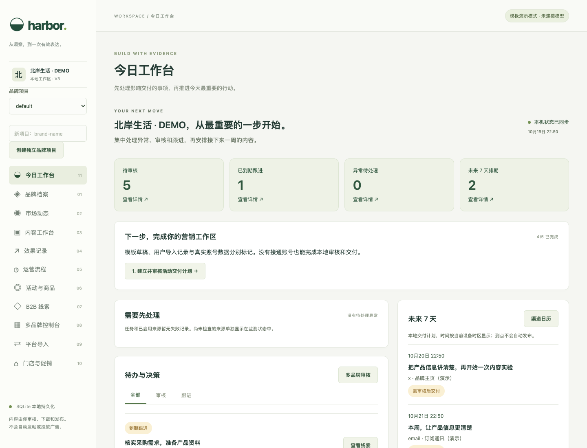
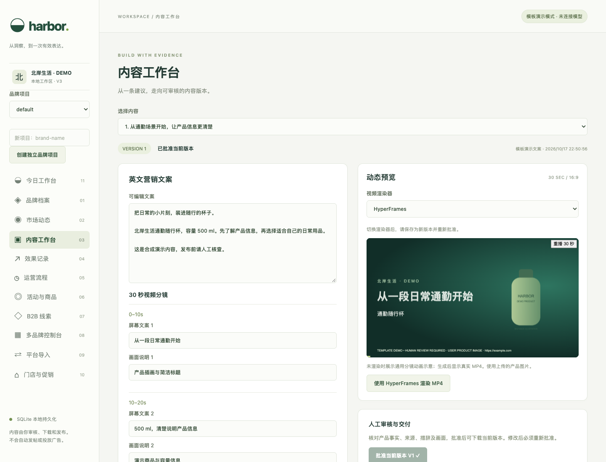
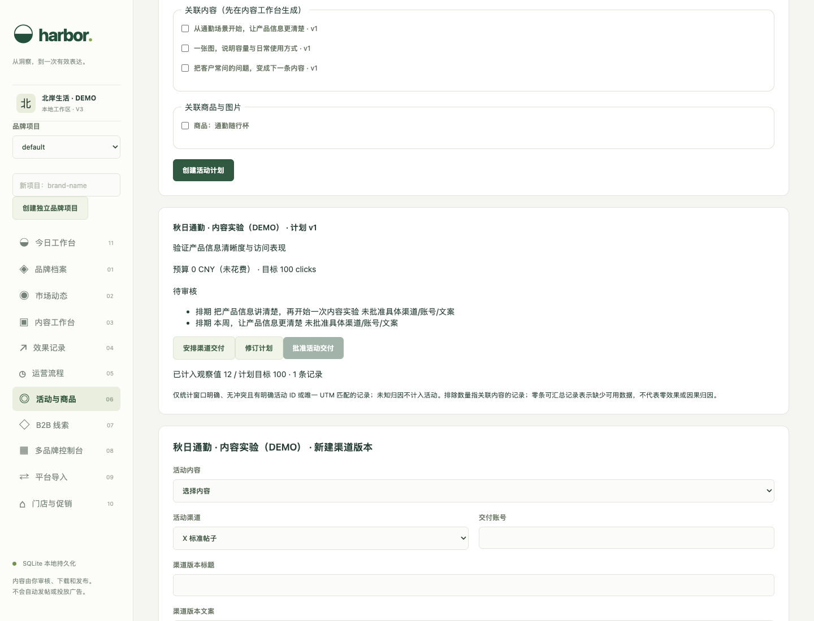
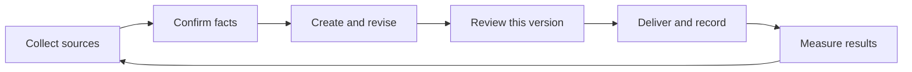

<div align="center">


**English** · [简体中文](README.zh-CN.md)

### From signals to action.

A local-first marketing workspace built around evidence, human review and clear next steps.

[](https://github.com/xliang-L/harbor/actions/workflows/ci.yml) [](LICENSE.md) [](https://nodejs.org/) [](https://www.typescriptlang.org/)

[Quick start](#quick-start) · [Preview](#preview) · [Capabilities](#capabilities) · [Documentation](#documentation) · [Contributing](CONTRIBUTING.md)

</div>

Harbor is an open-source, local-first marketing workspace. It connects source material, brand facts, content versions, channel approvals, manual delivery and performance reviews, helping independent marketers and small-team operators work through a complete marketing cycle in one place.

Start with clearly labeled offline templates, or connect a model service compatible with OpenAI Chat Completions. Business records live in local SQLite databases. Enabling a model or source collection sends the relevant material to the services or sites you configure.

> **Current scope: a local, single-user workspace.** Operators publish, send emails and run ads on their external platforms. Harbor handles preparation, review, export, recordkeeping and analysis. Brand workspaces separate data; they do not provide multi-user permissions.

<a id="preview"></a>

## Product preview

### Start each day with a clear next step

Pending reviews, follow-ups, upcoming plans and fact issues appear together, with direct links to the records that need attention.



<table>
  <tr>
    <td width="50%"><strong>Content with its supporting evidence</strong><br />Edit copy and storyboards, approve specific versions, and preserve fact and source snapshots.</td>
    <td width="50%"><strong>Traceable campaign delivery</strong><br />Connect products, assets and channel plans, then check delivery requirements against actual approval states.</td>
  </tr>
  <tr>
    <td><a href="docs/images/studio.png"></a></td>
    <td><a href="docs/images/campaigns.png"></a></td>
  </tr>
</table>

<sub>Screenshots use an isolated synthetic DEMO workspace. Brands, sources and performance values are examples, not customer data or business results. The current application interface is in Simplified Chinese.</sub>

## One marketing cycle, six steps



| Step                      | What Harbor helps you do                                                                                                                               |
| ------------------------- | ------------------------------------------------------------------------------------------------------------------------------------------------------ |
| **Discover and organize** | Import evidence and read public webpages, RSS/Atom feeds and GitHub Releases, preserving source text, timestamps and change snapshots.                 |
| **Confirm usable facts**  | Confirm exact quotes for a brand or a specific product, set validity periods, flag potential attribute conflicts and inspect the impact of retraction. |
| **Create and revise**     | Propose action hypotheses from evidence, generate copy and storyboards, save immutable revisions, and preview or render videos from fixed templates.   |
| **Review and deliver**    | Check brand guidelines, content versions and scheduled times; export delivery packages with UTM links; record proof of manual delivery.                |
| **Measure and review**    | Preview and import metrics, validate reporting windows, and inspect observed results by campaign, channel, UTM and currency.                           |
| **Plan the next cycle**   | Manage B2B leads, contacts and follow-up tasks while keeping hypotheses, sources and history.                                                          |

## Why Harbor

**Keep evidence within its scope.** A fact about product A does not automatically apply to product B. Expired, retracted or potentially conflicting facts block related approvals and exports. Renewals retain the old records, and existing content still needs explicit review.

**Approve a specific version.** Approvals are bound to a content revision, brand guidelines and channel plans. Editing requires another review; completed deliveries and historical approvals remain available. Receipts are clearly labeled as manual records rather than platform verification.

**Make numbers explainable.** Every metric has an explicit reporting window. Identical values for the same window are skipped; overlapping cumulative windows or changed values raise conflicts. Invalid records and records without windows remain visible but stay outside aggregates. Corrections use a recorded reason, a void and a replacement.

**Make failure recoverable.** Source health, failed tasks and pending actions are visible separately. Failed saves preserve input, key forms guard unsaved changes, and content editors can detect newer revisions from another window. Model failures remain visible as failures.

<a id="quick-start"></a>

## Quick start

Use **Node.js 22.13 or newer**, preferably Node.js 24 LTS. The core workflow runs without model credentials, an external database or Docker.

```bash
git clone https://github.com/xliang-L/harbor.git
cd harbor
npm ci
cp .env.example .env
npm run build
npm start
```

Open **[http://127.0.0.1:4317](http://127.0.0.1:4317)**. On Windows, replace the copy command with `Copy-Item .env.example .env`. On macOS, you can also use the included `启动Harbor.command` launcher.

`MODEL_ENABLED=false` is the default: try the workflow with templates before enabling a model. The application binds to the local loopback address.

### Your first workflow

1. **Set up a brand:** enter the product, audience and market, then set goals and brand guidelines under campaigns and products.
2. **Prepare evidence:** import products or evidence, then confirm facts from the original text with an explicit scope.
3. **Create content:** generate action hypotheses, select one to draft, and review the copy, storyboard and citations.
4. **Review and deliver:** approve a specific version, create a channel plan, export a package, then record a receipt after manual publication.
5. **Record results:** enter the reporting window, preview the metrics and decide on the next experiment.

See the [user guide](docs/USER-GUIDE.md) for detailed steps and file formats. The `fixtures/` directory contains DEMO evidence, products, metrics, contacts and orders; replace IDs as needed before importing. Supporting documentation is currently in Simplified Chinese.

### Optional: connect a model

Configure a Chat Completions compatible service you are authorized to use in `.env`:

```dotenv
MODEL_ENABLED=true
MODEL_BASE_URL=https://your-provider.example/v1
MODEL_NAME=your-model-id
MODEL_API_KEY=your-api-key
```

Restart the application to use it. Generation requests include the current brand and selected evidence. Credentials stay on the server and are not sent to the browser. Remote endpoints require HTTPS; local services may use loopback HTTP. A successful connection check confirms reachability; model output still requires human review.

### Optional: render video

HyperFrames and Remotion use trusted templates. Current output is **30 seconds · 640 × 360 · 24 fps · H.264 · no audio**. Storyboard descriptions do not generate arbitrary animations.

Video rendering also requires Google Chrome, FFmpeg and ffprobe. Optional npm binaries are available for macOS Apple Silicon. In other environments, specify paths in `.env`:

```dotenv
HYPERFRAMES_BROWSER_PATH=/path/to/chrome
HYPERFRAMES_FFMPEG_PATH=/path/to/ffmpeg
HYPERFRAMES_FFPROBE_PATH=/path/to/ffprobe
REMOTION_BROWSER_PATH=/path/to/chrome
```

<a id="capabilities"></a>

## Capabilities and integrations

| Capability              | Available today                                                                                         | Integration scope                                                                                                    |
| ----------------------- | ------------------------------------------------------------------------------------------------------- | -------------------------------------------------------------------------------------------------------------------- |
| Public sources          | Read-only adapters for webpages, RSS/Atom and GitHub Releases, with scheduled checks and snapshots      | Subject to site access rules, network availability and API limits. No login or anti-bot bypass.                      |
| Content and video       | Templates or a configured model, revision editing, human approval and two video renderers               | Users configure the model and rendering dependencies. Videos use fixed templates.                                    |
| Campaigns and channels  | Products, assets, campaigns, channel copy, UTM links and manual receipts                                | LinkedIn, Instagram, X, search ads and email are local draft formats. Publishing and ad execution happen externally. |
| Metrics and attribution | Manual entry, CSV/JSON imports, reporting-window validation, CTR/CPC/CPA                                | Aggregates observed values. Causal attribution, MMM and automatic ROAS claims are outside the current scope.         |
| GA4                     | Read-only reports through the official Data API                                                         | Requires authorized credentials and a property configured by the user. Disconnected by default.                      |
| Postiz                  | Read-only channel and post-status adapter                                                               | Requires an instance, key and channels. It does not publish or automatically create delivery receipts.               |
| Shopify / HubSpot       | Local mappings for product CSV and contact JSON imports                                                 | File imports; live account synchronization is not available.                                                         |
| B2B and retail          | Lead follow-ups, unsent outreach drafts, inventory/sales/refund imports and manual promotion redemption | Email sending, POS and payment execution are outside the current scope.                                              |

See the [platform matrix](docs/PLATFORMS.md) for adapter configuration, validation limits and reference APIs.

## Data and runtime

```text
data/harbor.sqlite                     Default workspace
data/projects/<project>/harbor.sqlite  Other brand workspaces
artifacts/                            Exports, videos and render logs
```

- Each brand has a separate SQLite database with persistent tasks and records. Each brand allows up to three concurrent tasks.
- Source schedules run while the local service is running. They pause when the computer sleeps or the service exits. After a restart, interrupted tasks are marked as failed and can be retried manually.
- Same-origin requests, write idempotency, version checks and approval checks are enforced by the server. Public fetching validates DNS and destination IPs, with response-size limits and timeouts.
- The application currently serves one local user. Multi-user authentication, RBAC, public deployment and high availability are not provided.
- Back up with the SQLite backup API, or stop the service before copying data and artifacts. Copying only the main database while it is running may omit data in the WAL.

`.env`, databases, workspace data and generated artifacts are excluded by `.gitignore`. External requests for models, source collection and optional platform APIs follow their respective configuration.

## Development and verification

```bash
npm run dev           # Vite + Express development mode
npm run format        # Format source and documentation
npm run format:check  # Check formatting
npm run lint
npm run typecheck
npm test              # Temporary databases + mocked external services
npm run build
npm run test:e2e      # Isolated data + local Chrome
```

Browser regression tests currently use the macOS Google Chrome path and port `4319`. Real models are disabled in the test configuration. The video flow performs an actual render and download, so it takes longer. `npm run test:public` performs separate live source checks and is excluded from the default test suite.

```text
src/app/             Application shell, navigation and draft protection
src/features/        UI grouped by brand, content, campaigns, CRM and other workflows
src/components/      Shared UI components
src/shared/          Frontend types, formatting and workspace context
src/styles/          Application styles
server/routes/       API endpoints and request validation
server/domain/       Business rules and metric projections
server/connectors/   Source, file and read-only platform adapters
server/services/     Content generation
server/storage/      Brand workspaces and SQLite
server/rendering/    Video preview, render workers and trusted templates
scripts/             macOS launchers and explicit verification tools
tests/server/        Domain and API regressions
tests/e2e/           Browser workflow regressions
fixtures/            Synthetic example data
docs/                Guides, architecture and product screenshots
.github/             CI and contribution templates
```

<a id="documentation"></a>

## Documentation and contributing

The README is available in [English](README.md) and [简体中文](README.zh-CN.md). The guides below are currently in Simplified Chinese.

| Document                                        | Contents                                                                                 |
| ----------------------------------------------- | ---------------------------------------------------------------------------------------- |
| [User guide](docs/USER-GUIDE.md)                | First workflow, fact review, delivery, metrics and import formats.                       |
| [Architecture and design](docs/ARCHITECTURE.md) | Module boundaries, approvals, security rules, design references and dependency licenses. |
| [Platform matrix](docs/PLATFORMS.md)            | Implemented adapters, configuration and capabilities still outside the current scope.    |
| [Roadmap](docs/ROADMAP.md)                      | Current capabilities, known limits and priorities.                                       |
| [Contributing](CONTRIBUTING.md)                 | Environment setup, verification, issue reports and Pull Request expectations.            |
| [Security policy](SECURITY.md)                  | Runtime boundaries and private vulnerability reporting.                                  |

Reproducible bug reports, documentation improvements and focused Pull Requests are welcome. Harbor prioritizes correct facts, versions, approvals and metrics before expanding platform connectivity. Discuss requests in [Issues](https://github.com/xliang-L/harbor/issues).

## License

Harbor's own source code and documentation are licensed under the [MIT License](LICENSE.md). Dependencies retain their own terms. In particular, [Remotion](https://www.remotion.dev/license), [GSAP](https://gsap.com/standard-license/) and [FFmpeg](https://ffmpeg.org/legal.html) have their own conditions for use and distribution; Harbor's MIT license does not replace them.

<div align="center">
  <sub>From a grounded signal to a considered next step.</sub>
</div>
