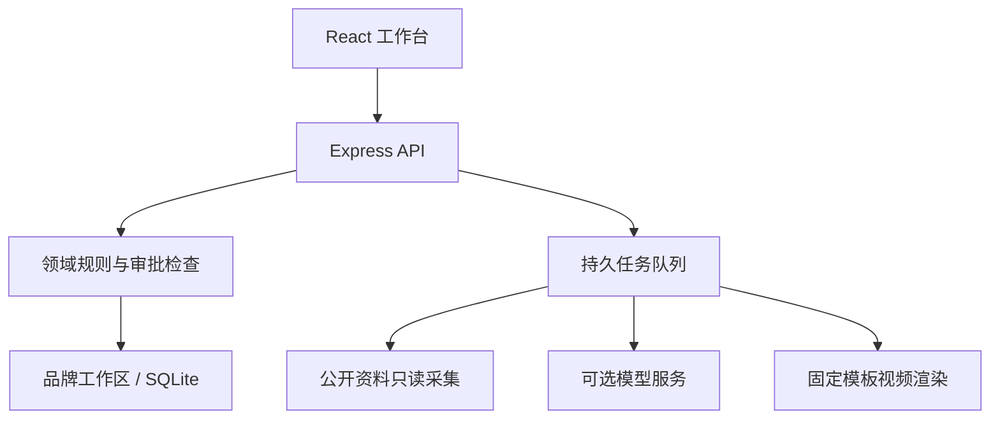

# 架构与设计

Harbor 使用 React、TypeScript、Express 与 SQLite。它是面向本地单用户的模块化应用，不依赖外部数据库或 Agent 编排服务。

## 请求与存储

`server/storage/workspaces.ts` 按品牌路由到独立 Store；默认库为 `data/harbor.sqlite`，其他库位于 `data/projects/<id>/harbor.sqlite`。品牌上下文必须一致，不能通过更换对象 ID 跨库读取或写入。

`server/store.ts` 使用 SQLite 事务保存 JSON 状态。新领域字段以读取默认值兼容旧库；当前适合小规模本地数据，尚未实现分表、全文索引或大规模归档。

## 模块地图

| 位置                                      | 职责                                               |
| ----------------------------------------- | -------------------------------------------------- |
| `src/main.tsx`                            | 应用入口、品牌切换、导航、编辑保护及内容工作台。   |
| `src/Overview.tsx`                        | 今日待办、事实风险、来源状态、排期与效果质量入口。 |
| `src/Planning.tsx`                        | 规范、商品、素材、活动与交付检查。                 |
| `src/Workflows.tsx`                       | 来源、事实、行动、渠道日历与批量指标。             |
| `src/CRM.tsx`、`Retail.tsx`、`Orders.tsx` | B2B 跟进、零售与订单文件流程。                     |
| `server/domain/`                          | 事实、活动、指标、CRM 和零售的领域规则。           |
| `server/workflows/`                       | 请求校验、业务 API、审批、导出和只读集成入口。     |
| `server/connectors/`                      | 网页、订阅、文件、GA4 与 Postiz 适配器。           |
| `server/providers/model.ts`               | 模型传输、结构校验、超时与服务端凭据。             |
| `server/generate.ts`                      | 建议、文案、引用及事实依赖校验。                   |
| `server/video.ts`、`video/`               | 受信模板预览、渲染、产物验证与失败日志。           |
| `tests/`                                  | 领域规则、API 契约和浏览器主流程。                 |

## 正确性约束

### 事实与版本

事实区分品牌通用和具体商品，保留来源、逐字引用、确认人、适用时间及撤回记录。结构化属性的不同值只标为潜在冲突，不做语义真伪判断或单位换算。

内容版本保存自己的品牌、证据和事实快照。审批与导出核对当前事实登记；模型等待期间事实失效，也会在保存前阻断。有效期采用含起始、不含截止规则，未来排期同时检查当前与计划时点。

普通改稿保留事实依赖。明确复核全文、分镜和新依据后，才能生成新版本脱离旧依赖。续期追加新事实，不覆盖旧记录或自动恢复旧审批。

### 审批与交付

审批在服务端绑定内容修订、规范及渠道计划。人工回执绑定具体版本、账号、渠道和实际交付时间，保存当时快照。撤销追加操作者、原因和时间，保留原始记录，不删除外部帖子。

### 指标质量

指标窗口、读取时点和报告元数据分别保存。相邻半开窗口可累计；同窗同值去重，包含、部分重叠或同窗数值变化均形成冲突。读取时间、时区标签和币种变化不能把同一流量变成独立样本。

历史缺窗口、损坏、冲突和撤销记录保留，但排除汇总。`metricQuality` 是复盘、归因和活动反馈共用的资格投影，不任意选取一条冲突数据，也不按天数拆分汇总值。

### 外部请求

模型输出作为 JSON 数据处理，不执行任意代码或来源内指令。请求有超时、体积和结构限制，凭据不发送到浏览器。逐字引用、事实引用及数字检查不能代替语义核实。

公开抓取检查 DNS 解析结果，固定目标 IP，拒绝私网及保留地址，不跟随跳转。API 写入有同源、幂等和版本检查；这些措施不构成多人身份认证。

## 测试与运行

`*.test.ts` 使用临时 SQLite 和模拟模型/平台；`*.e2e.ts` 使用隔离工作区与真实 Chrome。公开网络验证是单独命令，不包含在默认测试中。

每品牌最多 3 个并行任务。重启后，运行中断的任务标记失败供人工重试；来源订阅在服务运行时继续检查。没有系统级常驻服务、集群锁或高可用保证。

## 设计参考与第三方许可

参考的是职责和工作流，未复制以下项目源码：

- [Pomo](https://usepomo.ai/)：公开介绍中的信号、决策、人工审核与结果回流。
- [Postiz](https://github.com/gitroomhq/postiz-app)、[Frappe CRM](https://github.com/frappe/crm)：渠道计划、集中线索与跟进界面的产品组织方式，相关项目采用 AGPL-3.0。
- [Plausible](https://github.com/plausible/analytics)：导入窗口与明确冲突提示，AGPL-3.0；Harbor 不自动裁剪汇总窗口。
- [Luxon](https://github.com/moment/luxon)、[date-fns](https://github.com/date-fns/date-fns)：半开区间边界，MIT；Harbor 自行实现严格输入校验。
- [Payload](https://github.com/payloadcms/payload)、[OpenLineage](https://github.com/OpenLineage/OpenLineage)：版本快照与对象依赖，分别采用 MIT、Apache-2.0。

本项目源码的 MIT 许可不覆盖第三方组件。HyperFrames 为 Apache-2.0；Remotion 使用自己的许可，GSAP 使用 Standard License；FFmpeg 与 npm 预编译发行包有各自许可及分发条件。详见 [Remotion](https://www.remotion.dev/license)、[GSAP](https://gsap.com/standard-license/)、[FFmpeg](https://ffmpeg.org/legal.html) 及锁定发行包中的 LICENSE/NOTICE。仓库不分发 `node_modules` 或这些工具的二进制。
